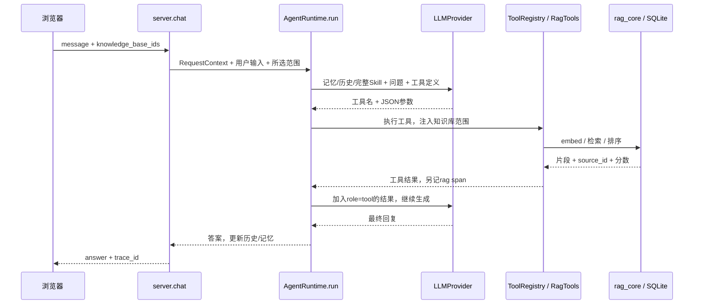

# 三天把“研发文档问答”讲清楚

适用情况：理解 LLM/RAG 的基本原理，但不熟悉这份代码，三天后需要面试 AI 应用开发岗。当前事实、验收和后续实现优先级以 [PLAN.md](PLAN.md) 为准。本文是学习与演示材料，不表示你已经掌握，也不把计划中的能力写成已实现。

先只准备这一个 AI 主项目。Java/Go 助手可以补充语言能力，但不要求三天内同时讲透三个 Agent。模块化和 Jenkins 保留在部署层；介绍项目时先讲用户问题与请求链路，暂时不用背 12 个模块名、全部设计模式或编译细节。

## 1. 项目到底解决什么

目标场景：研发人员面对多份接口、部署和排障文档，需要快速找到答案，并知道答案依据来自哪里。当前实现是个人原型，公开 CMRC2018 语料用于演示；没有企业用户、真实工单处理收益或线上生产规模证据。

用户操作：建立一个笔记本 → 上传文档 → 提问 → 查阅返回的来源 → 点 trace 检查具体查询和命中。Agent 的额外能力是选择检索工具、读回工具结果后继续生成；只读一次向量再拼提示词的固定 RAG 则不需要这个循环。

90 秒介绍草稿（先理解、按实际贡献改写，再说）：

> 我准备的项目是研发文档问答原型，目标是让研发人员从选定文档中查资料，并能检查来源。用户上传文件后，系统转成 Markdown、切块并存储向量。提问时，Python Agent 将模型返回的工具调用交给检索工具执行，把结果放回上下文，再生成回复。检索范围由服务端注入，trace 会记录查询、来源和耗时。部署使用 Docker/Jenkins，业务模块从编译产物加载。目前我能展示离线链路和应用演示测试；真实模型的效果评测、严格证据闸门和持久工作流还需要补齐。

这段不能替代个人贡献：明确哪些是自己写的、哪些由 AI 辅助完成、哪些只是本轮阅读和验证。只有实际做过并能解释的内容，才能使用“我实现了”。

## 2. 只沿着这一条请求读代码



模型可以多轮调用工具，上图只画正常的一次检索。离线 Mock 可能直接原样返回工具 JSON，不能据此说已经验证自然语言答案质量。

| 阅读顺序 | 去哪里找 | 必须回答的一个问题 |
|---|---|---|
| 1 | [server.py](../apps/ragnotebook/server.py)，找 `chat`、`runtime = AgentRuntime` | 请求有哪些字段，模型/记忆/工具在哪里装配？ |
| 2 | [agent_runtime](../modules-src/agent-runtime/agent_runtime/__init__.py)，找 `run` | 第一次给模型什么，为什么收到工具调用后还要再调模型？ |
| 3 | [llm_gateway](../modules-src/llm-gateway/llm_gateway/__init__.py)，找 `generate` | tool_calls 如何从 HTTP JSON 变成 ToolCall？ |
| 4 | [tool_runtime](../modules-src/tool-runtime/tool_runtime/__init__.py)，找 `execute` | 模型只能返回参数，真正执行函数的是谁？ |
| 5 | [rag_tools](../modules-src/rag-tools/rag_tools/__init__.py)，找 `search`、`_run_search_tool` | scope 从哪里来，返回的引用包含哪些字段？ |
| 6 | [rag_core](../modules-src/rag-core/rag_core/__init__.py)，找 `SqliteVectorStore.search`、`hybrid_search` | 当前如何排序，向量/关键词融合怎么做？ |
| 7 | [ingestion](../modules-src/ingestion/ingestion/__init__.py)，找 `parse`、`chunk` | 文档如何变成块，默认块大小与重叠是什么？ |
| 8 | [skill_runtime](../modules-src/skill-runtime/skill_runtime/__init__.py)，找 `render` | Skill 如何匹配并加载，是否是流程执行引擎？ |

阅读源码用于学习。演示运行仍通过 `runtime_boundary.py` 加载 artifacts 下的 `.pyd/.so`。本机有旧二进制签名与新源码不一致，不能以源码看起来正确代替交付验证。

第一题现在就练：“请查资料，说明当前项目向量存储怎样实现。”尝试不看文档说出：接收请求 → 构造 trace 上下文 → 载入历史和 Skill → 模型选择 search → 注入 scope → SQLite 中读向量并点积排序 → 带来源回传 → 第二次生成。卡住时只回到对应函数。

## 3. 岗位要求怎样对应到证据

| 岗位能力 | 当前可以展示 | 当前缺口 / 三天内怎么处理 |
|---|---|---|
| Python 开发 | FastAPI 请求、异步 provider、工具注册、分块/排序 | 手工解释一处函数，自己改一项低风险提示词或演示问题并观察结果 |
| LLM 基础与提示词 | 系统提示词、tools schema、role=tool、上下文历史 | 讲清 token/context window、采样不确定性、幻觉和工具调用；项目没有训练/微调 |
| RAG | 文档转换、字符/token/结构分块实验接口、向量/词面/BM25/RRF 检索、结构化来源、笔记本 scope | BGE 检索已有 60 题离线实验；真实 LLM 生成质量仍未验证；hash 只是测试向量，不是语义模型效果 |
| Agent | 模型选择工具、执行结果回传、循环上限 | 未做自主长期任务；选过工具不等于执行成功 |
| 工作流编排 | 自写模型—工具循环 | 没有持久状态图、暂停/恢复、审批建单。Skill 写着步骤不能代替工作流 |
| Agent Skill | 按 always/触发规则加载完整 SKILL.md | 解释“可复用操作说明”，不称为自治规划器 |
| Harness Engineering | 上下文装配、工具范围、文件边界、轮数、无证据停止、trace、现有测试 | 当前有部分运行约束；无逐句引用验证、wall-clock deadline、完善授权和恢复机制，讲清现有与缺失 |
| LangChain/LangGraph/Hermes | 当前实现未使用 | 显式承认缺口，阅读/运行官方小例子后仅称“独立练习过” |
| 稳定/高效/安全 | 构建闸门、候选健康检查与回滚配置、文件目录限制 | 无本轮压测、无用户鉴权，不声称生产级或高并发 |
| 效果迭代 | 可查看 query、命中来源、耗时和工具轨迹 | 做下方固定案例记录；不能用 Mock、词面分数或答案长度报准确率 |

学历、专业与毕业届别按真实经历核对，项目不能替代职位的硬条件。

框架只优先理解一个具体问题：如果任务需要跨进程重启继续、人工确认再写操作，自写循环需要补状态持久化与恢复。LangGraph 官方区分固定路径的 workflow 与模型动态选择的 agent；interrupt 需要 checkpointer 和 thread_id，恢复时节点可能重跑，所以前置副作用要考虑幂等。[workflows/agents](https://docs.langchain.com/oss/python/langgraph/workflows-agents)、[interrupts](https://docs.langchain.com/oss/python/langgraph/interrupts)。

三天内有余力时，最多花一小时跑官方批准/拒绝例子并解释 state/node/edge、暂停/恢复，保存在个人练习环境；不接入当前产品，不因此写“本项目用 LangGraph 实现”。完成这一步以前仍是资料学习。

JD 的 Hermes 具体所指未得到官方招聘页确认。如果指 NousResearch Hermes Agent，先通过[官方仓库](https://github.com/NousResearch/hermes-agent)了解其 agent/工具/skills 体系，面试可澄清指代；当前项目未接入，三天内不安排整个平台迁移。

## 4. 准备三个设计取舍

每个回答使用“遇到的问题 → 选择 → 代价 → 下一步”的顺序。

**为什么增加 Agent 循环？** 问题可能需要换查询、精确查术语或读原文，工具返回后由模型决定下一步。代价是多次模型请求带来延迟、费用和不确定性。简单问答可以选固定检索流水线；本项目尚无消融实验，不能声称 Agent 比固定 RAG 更准确。

**为什么传 scope？** 同一个服务中有不同笔记本，检索必须只查当前选择。`ToolRegistry` 在执行时注入 runtime_context，`RagTools` 使用其中的知识库范围，分页读原文也核对 source_id。代价是检索可能无结果；而用户选择范围不等于后端鉴权，未来需在取得用户身份后再核验访问权。

**为什么使用 SQLite？** 个人原型易复现、无需另建数据库；当前向量保存为 JSON，点积搜索适合小数据验证。代价是搜索需要扫描读取，规模扩大后会慢；没有实现 pgvector/ANN，不能说“向量库可无痛切换”。

部署追问时再补：接口接口规范与编译交付便于固定模块边界、检查版本来源；代价是构建复杂、跨平台 ABI 限制和源码/产物一致性风险。本项目的三处本机签名不一致正是一个待解决的例子。Cython 没有经过性能对比，不声称它让推理更快；二进制也不提供绝对保密。

## 5. 五分钟演示：先证明查到了什么

1. 先在服务器公开入口按第 10 节完成精选问题、来源与 trace 演示。下面的上传步骤只适用于受保护的私有工作区，公开演示不开放上传。本机启动是可选练习，需匹配二进制工件；不使用源码模式绕过边界。
2. 首先展示已有 CMRC2018 笔记本和“请查资料，什么是静电感应？”。核对 trace 中存在 rag span、scope 是当前笔记本、命中来源来自该范围。
3. 建一个独立笔记本“项目说明练习”，手动上传本仓库最新 README.md 与 docs/ARCHITECTURE.md。上传的是公开项目说明，避免用企业或个人敏感文档。不要上传本学习指南，免得检索把练习答案与项目事实混在一起。
4. 问“请查资料，当前向量存储是 FAISS 吗？”先看命中片段，再看答案。资料应说明 SQLite JSON 向量/NumPy 排序。Mock 只检查返回 JSON 与来源；接入真实模型以后才核对自然语言答案是否忠实。
5. 点 trace，说明一次查询、命中数、source_id、score、rag/llm/tool 耗时各说明什么。分数表示检索排名依据，不是答案正确概率。
6. 问“请查资料，当前是否已实现持久工作流或接入 Web MCP？”让演示暴露边界；答案应对应文档写的尚未实现/接入。当前真实模型未复验，不能保证现场会正确回答。

演示遇到错误先保留 trace 和输入，定位上传/embedding/工具/LLM/生成哪一步失败。网络、模型或认证失败时展示事先保存的真实记录与离线链路，明确说明模式；不能把录像或固定 Mock 文本说成正在执行的真实模型结果。

API 手动复演（已启动本机服务时；本段会调用当前配置的 provider，真实模型可能计费）：

```powershell
$interviewBody = @{
    user_id = 'interview-practice'
    session_id = 'practice-01'
    message = '请查资料，什么是静电感应？'
    knowledge_base_ids = @('cmrc2018-demo')
} | ConvertTo-Json
$interviewReply = Invoke-RestMethod -Uri 'http://127.0.0.1:8000/api/chat' `
    -Method Post -ContentType 'application/json; charset=utf-8' `
    -Body ([Text.Encoding]::UTF8.GetBytes($interviewBody))
$interviewReply
Invoke-RestMethod -Uri ('http://127.0.0.1:8000/api/trace/' + $interviewReply.trace_id)
```

## 6. 六个固定案例，先记录失败再谈提升

| 案例 | 输入/操作 | 应看见什么 | 如何判断 |
|---|---|---|---|
| 命中文档 | 项目说明笔记本：“请查资料，当前向量存储是 FAISS 吗？” | SQLite/NumPy 相关来源 | 来源命中和答案忠实分开评分 |
| 能力边界 | “请查资料，Web 现在接入 MCP 了吗？” | 尚未接入 Web 的依据 | 不能把独立模块冒充主链路 |
| 未提供信息 | “请查资料，生产系统每天服务多少用户？” | 文档无生产规模数据 | 真实模型应说无法据资料确认；当前不是硬性拒答保证 |
| 知识库范围 | 切回 CMRC2018，再问 FAISS 问题 | trace 的来源全部属于 CMRC2018 | 不得检出项目说明笔记本；无相关资料要单独记录 |
| 不检索的模型 | 阅读 `test_reminders_are_bounded_and_never_loop_forever` | 最多两次提醒后仍不检索，返回 `NO_EVIDENCE_ANSWER` | 停止原因是 `retrieval_required_not_met`；不要把“提醒过”算成检索成功 |
| 后续追问 | 同一会话追问上次问题，再换会话 | 核对实际上下文与记忆行为 | 进程内历史有联合键，SQLite 记忆缺 session_id 过滤；不能声称绝对隔离 |

自己建立记录表，每条记：模式（Mock/真实模型、hash/BGE）、问题、所选笔记本、期望来源、实际来源、答案关键结论、trace_id、总耗时、是否通过、失败原因。可以留在被忽略的 reports/，不用提交一次性报告。

检索指标示例：先标注每题相关文档，再计算 Recall@k = 前 k 个检索结果覆盖的相关文档数 / 所有标注相关文档数。答案正确性由人工依据文档检查，与检索命中率分开。小样本要报分子/分母；某条用例通过不能说成“项目准确率提升”。质量比较至少固定同一问题集、语料、模型/embedding、检索 k 与提示词，只改变一个变量并保留失败记录。

现有 `evaluation.evaluate_qa` 的 faithfulness 是词面重叠启发式；answer_relevance 不再按答案长度生成，judge 失败保持 `unavailable`。检索指标已改为 Recall@k、Precision@k、MRR@k、nDCG@k，实测见 [EXPERIMENTS.md](EXPERIMENTS.md)。上述表仍是人工复演计划，本轮没有生成真实模型的六例效果分数。

## 7. 三天安排与过关标准

| 时间 | 做什么 | 当天必须交给自己看的结果 |
|---|---|---|
| 第一天，约 4 小时 | 20 分钟讲用户问题；2 小时按第 2 节读链路；1 小时复演服务器公开流程并看 trace；40 分钟脱稿复述 | 手画一条请求图，解释两次 LLM 请求，指出 5 个关键函数，录一段 90 秒介绍 |
| 第二天，约 4 小时 | 执行固定案例；整理三个设计取舍；能访问受保护私有工作区时再建项目说明笔记本；有余力再做 LangGraph 独立练习 | 一份带模式/来源/失败原因的记录表，5 分钟演示录像；每项设计都能说出代价 |
| 第三天，约 3 小时 | 两轮模拟问答；修订简历中夸大的能力；准备截图/trace/离线备用；停止加功能 | 90 秒介绍 + 5 分钟演示 + 下方追問；至少能解释一项自己做的修改 |

如果当天只有两小时，优先请求链路、演示和设计取舍；框架练习降为阅读并如实说明。若链路仍讲不清，继续缩小介绍到“文档上传、检索、来源、trace”，不用硬讲记忆/MCP/编译全部细节。

每次练习不要直接背答案：先自行解释 → 对照对应函数 → 找一处错误 → 重新说一次。录音里出现“框架会自动处理”“应该已经做了”时，回到具体实现找证据。

## 8. 面试追问速查

| 问题 | 回答必须包含 |
|---|---|
| RAG 为什么不等于微调？ | 文档在推理时检索并加入上下文，模型权重未改变；资料可更新，但检索错仍会导致错误 |
| 分块参数是什么？ | 当前按抽取段落/页后按字符切块，默认 500 字符、50 重叠；不是 token 切分，也不是调参最优结论 |
| 混合检索如何融合？ | 向量与词面两路排名，用加权 RRF；默认 alpha=0.5，按 1/(60+rank) 融合，不直接加不同尺度的原始分数；实验里另有 BM25+向量融合和词面重排，但没有生产 Cross-encoder reranker |
| 模型如何调用 Python？ | 模型输出工具名/JSON，服务解析成 ToolCall，注册表调用函数，结果以 tool 消息回传；模型本身没有执行 Python |
| Skill 与 tool 有什么关系？ | Skill 提供可复用操作指令，tool 是可执行函数/能力；本项目 Skill 不是审批/恢复状态机 |
| Harness 在哪里？ | 上下文与工具装配、检索范围注入、轮数限制、文件边界、trace 和验收测试；指出 guard 与授权仍有缺口 |
| 为什么不是生产系统？ | 缺鉴权、压测、严格证据验证、持久工作流恢复与可信评测；小数据扫描式检索也有容量限制 |
| 有流式输出吗？ | 有 SSE 传输接口，完整生成后只发一次，当前没有逐 token 生成 |
| 多会话安全吗？ | 历史按用户/会话放内存，SQLite 记忆仅按 namespace/user_id；客户端 user_id 不是可信身份，隔离仍需补 |
| 性能如何？ | 展示一次 trace 耗时并限定模式和样本；60 题离线检索 vector 约 10.4 ms、BM25 约 10.3 ms，但无 p95、并发或成本基准，不能报虚构数字 |
| 用了 LangGraph 吗？ | 本项目自写循环；如独立例子确实运行成功，可单独讲练习，明确未集成 |
| 你本人负责什么？ | 具体文件、修改原因、验证步骤、失败记录；准确区分自主完成与 AI 辅助，不背无法证明的贡献 |

简历可以先使用中性条目：“研发文档问答原型：支持笔记本内文档检索、结构化来源与调用 trace；实现/参与了【填自己能解释的具体部分】，通过【填真实运行的验证】核对流程。”删去没有证据的“生产级、准确率提升 X%、高并发、完善多租户、全框架熟练”等表述。

## 9. 当前核验结果怎样说

2026-10-08，本机现有 Windows CPython 3.11 工件：

- `RAG_EMBED=hash` 下二进制运行验收输出 `COMPILED_AGENT_OK`。
- 临时 STATE_DIR、空模型 key、hash 模式的应用演示测试 7 项通过。
- 额外 API 上传复演因系统临时目录写权限失败，提升权限请求未获批准；完整“新建→上传→问答→trace”未列为本轮已通过项。第 5 节是待操作者实际复演的步骤。
- 接口规范检查 11 项通过、90 个 subtests 通过、3 个 subtests 失败，涉及 llm-gateway/observability/evaluation 的本机旧产物签名。不能说交付闸门全绿；需在目标构建流程核实重建。
- 对“不检索的 provider”进行本机二进制复演：记录两次 retrieval_guard，随后仍返回 `UNRETRIEVED_ANSWER`。因此必须把提醒和严格保证区分开。

以上是第一阶段本机历史结果，不代表真实 DeepSeek/BGE 质量评测。服务器公开演示是随后新增的执行范围，最终交付记录以 PLAN 文末为准。2026-11-10 的 BGE 检索、切块、图/框架 PoC 和模型错误回归见第 11 节与 [EXPERIMENTS.md](EXPERIMENTS.md)。

复验命令（现有匹配环境中）：

```powershell
$env:RAG_EMBED = 'hash'
.\.venv\Scripts\python.exe scripts/verify_compiled_runtime.py
.\.venv\Scripts\python.exe -m pytest specifications/test_specification.py -q

# 应用测试在独立进程中使用临时状态，避免覆盖已有数据库；不影响模型密钥文件。
$env:STATE_DIR = Join-Path $env:TEMP ('dev-agent-interview-' + [guid]::NewGuid().ToString('N'))
$env:DEEPSEEK_API_KEY = ''
.\.venv\Scripts\python.exe -m pytest apps/ragnotebook/tests/test_cmrc2018_demo_workflow.py -q
```

执行测试后关闭这个终端，避免 hash/空 key/临时状态环境设置影响正式演示。应用测试在某些情况下可能建立临时用户笔记本，现有测试会清理；本轮运行后 Git 工作区只出现文档改动。

## 10. 主页演示怎样讲清楚

打开[服务器公开演示](http://43.153.176.182:8088/projects/apps/rag/)，选一个精选问题，再查看输出、检索来源和执行记录。当前为 Mock + hash，Mock 展示工具 JSON，不是自然语言回答质量验收。CMRC2018 是用于复现流程的公开阅读材料；标题中的研发文档问答是目标业务，本次公开数据不是企业内部研发数据。

依次解释这四件事：

1. 浏览器只发送一个固定问题。HTTP 适配层设置 CMRC scope 和独立身份，禁止上传、写工具及浏览器密钥。
2. AgentRuntime 通过工具注册表调用已发布的 RAG 二进制，工具结果进入下一次模型请求；有 trace 才能核对是否发生检索。
3. 公开适配层在返回前检查成功 rag span、非空命中及 CMRC 来源。这个附加门禁只作用于公开接口，不宣称私有 Agent 的两次提醒已变为严格证据保证。
4. Jenkins 先跑模块单测、编译、接口规范和应用检查，候选服务实际问答通过后才切换。源码供构建和学习，运行镜像通过二进制来源检查启动。

问到取舍时说明：固定问题、单并发和五分钟缓存控制公开演示范围；缓存复用原答案和原 trace，不算本次模型调用。hash 便于小服务器启动，不能代表中文语义向量质量。命中来源证明检索执行过，尚不证明答案每句话都有证据支持。

练习时先自己指着页面说出请求路径，再打开 `apps/ragnotebook/public_demo.py` 的 `chat()` 与 `_has_retrieval()` 核对。至少亲手修改一个显示文案或固定问题后的校验，解释修改为何通过或被拒绝；个人贡献仍应按实际参与描述。

一个实际排障例子也可以拿来学习：Jenkins #9 的候选问答通过，但发布失败。脚本导出的模式和配置路径被 sudo 清除，Compose 使用了默认 DeepSeek 配置；修复在 `deploy_public_demo.sh` 的 `compose()` 中显式转交两个非敏感变量，并让回滚测试的 sudo 替身真的清理环境。你要能解释“为什么候选通过、正式切换却失败”和“测试为什么漏掉了它”。这是本轮 AI 辅助处理的记录，只有自己读懂并复核以后才能按实际参与程度讲述。

交付证据：AI Jenkins #10 与主页 #24 成功；73 项模块、6 项回滚、11 项严格接口规范、15 项应用检查及 12 个 Linux 二进制来源检查通过。八个问题的公网检索/trace/缓存复验通过，完整记录在 PLAN 文末。这里可以证明工具执行和交付边界，不能据此报真实模型准确率、并发能力或生产收益。

## 11. 12 道 RAG 面试题：原理、代码、命令、结果、限制

本节按 Issue #39 的 12 道题组织。每题都给出“原理与取舍 → 项目代码 → 演示命令 → 实际结果 → 限制 → 未完成项”。完整实验记录见 [EXPERIMENTS.md](EXPERIMENTS.md)，脚本索引见 [`experiments/README.md`](../experiments/README.md)。

统一前提：语料是 `data/kb/cmrc2018-demo/` 的 24 篇公开文档；问题集是 `experiments/qa_set.json` 的 60 题；真实 embedding 是 FastEmbed `BAAI/bge-small-zh-v1.5`；生成模型当前不可用，演示使用 Mock。所有结果都限定在这个环境，不外推到生产流量。

### 11.1 RAG 工作原理，与微调相比解决什么问题？

- **原理与取舍**：RAG 在推理时检索外部资料，把证据放进上下文再生成；知识更新靠改文档和索引，不改变模型权重。它适合私有资料、可更新知识和来源检查，但不能保证答案正确；返回来源编号也不等于引用真的支持结论。微调适合行为、格式和领域适配，两者可以组合。RAG 不一定更便宜，要算索引、检索、上下文 token 和维护成本。
- **项目代码**：`apps/ragnotebook/server.py` 的 `chat`；`modules-src/agent-runtime/agent_runtime/__init__.py` 的 `AgentRuntime.run`；`modules-src/rag-tools/rag_tools/__init__.py`；`modules-src/rag-core/rag_core/__init__.py`。项目没有 LLM 微调代码。
- **演示命令**：`python experiments/run_mock_agent_demo.py --backend fastembed --output experiments/results/mock-agent-demo.json`；服务运行时用 `python scripts/demo_rag_evidence.py --base-url http://127.0.0.1:18080 --question "请查资料，什么是静电感应？"`。
- **实际结果**：Mock Agent 演示用真实 BGE 检索到 5 个片段，停止原因 `answered_with_evidence`；生成是 Mock 工具 JSON。2026-11-11 轮换新 OpenRouter key 后，运行中的 0.9.0 服务返回真实检索命中（`008-静电感应` 等）和带引用的自然语言答案，HTTP 200；旧镜像没有 `agent_stop`，也没有做逐句人工核验，不能报准确率。
- **限制**：没有真实模型答案质量结论；没有把 Mock 文本说成模型回答。
- **未完成**：接入可用模型后，对同一问题记录答案、引用和人工核验结果。

### 11.2 完整 RAG 流水线包括什么？

- **原理与取舍**：索引阶段是数据接入 → 解析清洗 → 去重/来源/权限 → 切块 → 向量化 → 存储索引 → 更新删除；查询阶段是鉴权和范围 → 查询理解 → 召回 → 融合/重排 → 上下文组织 → 生成 → 引用检查 → 记录评估。FAISS 是向量检索库，不是完整数据库；索引可以增量更新；支持 PDF 不等于支持扫描件 OCR 和复杂表格。
- **项目代码**：`apps/ragnotebook/server.py` 的上传、聊天、删除路由；`modules-src/ingestion/ingestion/__init__.py` 的 `parse`/`chunk`；`modules-src/rag-core/rag_core/__init__.py` 的 `embed`/`retrieve`/`hybrid_search`；`modules-src/storage/` 的 SQLite 向量和状态；`modules-src/observability/` 的 trace。
- **演示命令**：`python scripts/demo_rag_evidence.py --base-url http://127.0.0.1:18080 --question "请查资料，什么是静电感应？"`；上传/删除路径由 `apps/ragnotebook/tests/` 的现有应用测试覆盖。
- **实际结果**：24 篇文档、字符 500/50 切块得到 86 块；检索命中、source_id、score 和 trace 可在演示脚本/页面看到。本轮没有重新执行线上上传和删除，不把既有测试写成新的线上验收。
- **限制**：SQLite JSON 向量 + NumPy 精确排序适合小数据；没有 ANN 索引；没有 OCR；删除后的检索可见性由现有测试覆盖，本轮未重跑。
- **未完成**：规模压测、增量索引性能、扫描件和复杂表格解析。

### 11.3 如何选择切块大小和重叠？

- **原理与取舍**：按文档结构、问题类型、embedding 输入限制和生成预算选择。小块定位准但缺背景，大块背景多但噪声和成本高；重叠保留边界信息，也增加重复。256—512 token、10%—20% overlap 只是实验起点，不是通用最优；字符数不等于 token 数。
- **项目代码**：`modules-src/ingestion/ingestion/__init__.py` 的 `chunk`（字符）、`chunk_tokens`、`chunk_structural`、`chunk_with_strategy`；`build_index(..., chunker=...)`。
- **演示命令**：`python experiments/run_chunking.py --backend fastembed --top-k 5 --output experiments/results/chunking-fastembed.json`。
- **实际结果**：char-500-50 为 86 块、构建 17.445 s、RSS 318.8 MB、证据完整率 1.0、vector R@5 0.9808；char-300-30 为 120 块；token-256-32 为 118 块；token-512-64 为 72 块；structural 配置块数与对应 token 配置接近。所有配置证据完整率均为 1.0，token/结构切块没有带来可观测检索提升。
- **限制**：`token` 是正则近似，不是模型 tokenizer；证据完整率只检查子串是否完整落在某个块中，不等于生成上下文不被截断；单次运行的耗时和 RSS 不是容量承诺。
- **未完成**：在更多文档类型和更长问题上验证切块收益；生产默认仍保留字符 500/50。

### 11.4 如何选择 Embedding？有哪些指标？

- **原理与取舍**：结合语言、领域、文本长度、部署资源、延迟、许可证和隐私选择；参考 MTEB/C-MTEB 的相关检索任务，再用项目数据验证。检索指标用 Recall@k、Precision@k、MRR@k、nDCG@k；STS 的 Pearson/Spearman、分类 Accuracy、聚类 V-measure 不能直接证明 RAG 检索效果。换 embedding 后不能混用旧向量。
- **项目代码**：`modules-src/rag-core/rag_core/__init__.py` 的 `make_embed`；`modules-src/evaluation/evaluation/__init__.py` 的 `ranking_metrics`；`experiments/run_retrieval.py`。
- **演示命令**：`python experiments/run_retrieval.py --backend fastembed --top-k 5 --output experiments/results/retrieval-fastembed.json`。
- **实际结果**：BGE-small-zh 向量检索在 52 道可回答题上 Recall@5=0.9808、Precision@5=0.2115（固定以 5 为分母）、MRR@5=0.9808、nDCG@5=0.9808、证据覆盖 0.9647、平均延迟 11.055 ms。
- **限制**：问题集是 AI 辅助整理并核对 evidence，不是独立人工标注；只有 24 篇文档；没有第二个中文 embedding 模型对照。
- **未完成**：资源允许时增加一个中文 embedding 模型，固定语料、切块、问题集和 k，记录维度、编码方式、质量、耗时和内存；不用 hash 结果替代。

### 11.5 除向量检索，还能怎样提高效果？

- **原理与取舍**：BM25/稀疏检索补错误码、术语、人名等词面匹配；向量与词面用 RRF 等融合；Cross-encoder 对候选重排；查询改写、多查询、问题分解；父子块/相邻块补全；HyDE 生成假设文档再检索。重排只能调整已召回候选，不能补回候选集中不存在的证据。
- **项目代码**：`modules-src/rag-core/rag_core/__init__.py` 的 `keyword_search`、`hybrid_search`、`bm25_search`、`bm25_hybrid_search`、`rerank_by_lexical_overlap`。
- **演示命令**：同 11.4 的 `run_retrieval.py`。
- **实际结果**：BM25 Recall@5=1.0、Precision@5=0.2154（固定以 5 为分母）、MRR@5=1.0、nDCG@5=1.0、证据覆盖 0.9776、延迟 10.239 ms；BM25+向量融合 Recall@5=1.0、MRR@5=0.9872，没有超过单独 BM25；当前 RRF 融合 MRR@5=0.9872；词面重排没有提升。权限题禁止命中均为 0。
- **限制**：这批题偏精确术语，词面方法占优；样本小；`rerank` 是词面重排，不是 Cross-encoder。
- **未完成**：Cross-encoder 重排、查询改写和多查询实验；生产默认检索不因这次结果切换。

### 11.6 什么是 Lost in the Middle？如何缓解？

- **原理与取舍**：部分长上下文任务中，模型对中间位置证据的利用弱于开头或结尾；上下文窗口大不等于所有位置都同样有效。可减少无关/重复内容、重排关键证据、控制上下文长度、分步检索、使用经验证的压缩。不能把同时改变长度、内容和位置的结果归因于位置效应。
- **项目代码**：`experiments/run_lost_in_middle.py`；上下文构造和干扰片段选择都在脚本内，不改生产提示词。
- **演示命令**：`python experiments/run_lost_in_middle.py --provider mock --output experiments/results/lost-in-the-middle-mock.json`。
- **实际结果**：8 个问题 × 3 个位置 = 24 条记录；全部是 `mock_not_evidence`，`quality_conclusion=unavailable`，`exact_contains_expected=false`、`cites_evidence_number=false`。这只证明脚本和上下文构造可运行。
- **限制**：没有真实模型位置效应结论；没有验证重排、去重或压缩的缓解效果。
- **未完成**：取得可用模型后，固定问题、证据和干扰片段，只改变位置，记录正确率和引用支持率；再单独测试一种缓解方法。

### 11.7 如何全面评估 RAG？

- **原理与取舍**：分开评估检索、生成和系统运行。检索看 Recall/Precision/MRR/nDCG、证据覆盖和延迟；生成看正确性、相关性、忠实性、引用正确率/覆盖率、无答案拒答；系统看端到端 p50/p95、错误率、调用次数、token/费用、峰值内存、导入耗时、更新删除可见性和权限隔离。忠实于上下文不等于上下文本身真实。
- **项目代码**：`modules-src/evaluation/evaluation/__init__.py` 的 `ranking_metrics`、`evaluate_qa`、`llm_as_judge`；`experiments/qa_set.json`。
- **演示命令**：`python experiments/run_retrieval.py ...`；`python -m pytest modules-src/evaluation/tests -q`。
- **实际结果**：60 题覆盖单跳/跨段/多跳/无答案/权限；dev 45、test 15，按文档划分，test 文档为 001、005、006、012、020。检索指标已实测；judge 失败返回 `status=unavailable` 和原因，`answer_relevance=None`，不再用答案长度补分。
- **限制**：faithfulness 仍是词面重叠启发式；没有真实模型生成质量、人工量表或 judge 失败率统计；问题集不是独立人工标注。
- **未完成**：真实模型生成评测、人工抽查、引用正确率/覆盖率、p95 和成本统计。

### 11.8 什么时候使用知识图谱或图数据库？

- **原理与取舍**：问题依赖实体关系、跨文档多跳、依赖/影响分析时，图结构可能更合适；图路径提供关系结构，向量检索补充原文证据。GraphRAG 还包括实体关系抽取、社区层次和社区摘要，不等于安装 Neo4j；代价是实体消歧、错误关系、构图、更新和权限传播。
- **项目代码**：`experiments/run_graph.py`、`experiments/graph_data.json`；只在内存建图，没有生产图数据库。
- **演示命令**：`python experiments/run_graph.py --backend fastembed --top-k 10 --output experiments/results/graph-fastembed.json`。
- **实际结果**：合成数据 6 个服务、8 个问题；向量检索和图 BFS 的平均实体召回都是 1.0，延迟分别为 10.232 ms 和 0.058 ms。
- **限制**：合成数据、问题模板化，不能代表真实企业文档；没有实体抽取、消歧、更新和权限传播。
- **未完成**：真实依赖资料上的图构建和人工评估；不引入生产第二数据库。

### 11.9 有哪些多次检索或自适应检索范式？

- **原理与取舍**：迭代 RAG 根据现有证据更新查询；Agentic RAG 由模型选择工具、读结果再决定下一步；FLARE 用预测的后续句子构造查询；Self-RAG 训练模型用反思 token 控制检索和评价。普通工具循环不能直接称为 FLARE 或 Self-RAG。
- **项目代码**：`modules-src/agent-runtime/agent_runtime/__init__.py` 的 `AgentRuntime.run`、`_record_stop`、`_retrieval_hit_count`；常量 `DUPLICATE_RETRIEVAL_MESSAGE`、`NO_EVIDENCE_ANSWER`。
- **演示命令**：`python experiments/run_mock_agent_demo.py --backend fastembed --output experiments/results/mock-agent-demo.json`；`python -m pytest modules-src/agent-runtime/tests -q`。
- **实际结果**：已选知识库时，提醒耗尽仍不检索返回 `NO_EVIDENCE_ANSWER`（`retrieval_required_not_met`）；解析到 `hit_count=0` 返回 `NO_EVIDENCE_ANSWER`（`no_evidence`）；重复 `(tool, arguments)` 不执行并记录 `duplicate_query`；正常有证据为 `answered_with_evidence`；达到轮数上限为 `max_tool_rounds`。Mock 演示命中 5 个片段，`retrieval_calls=1`。
- **限制**：调用预算由 `max_tool_rounds`（默认 10）控制，HTTP 层有 120 秒总时限，但 `AgentRuntime` 自身没有 wall-clock deadline；“有命中”不等于证据支持结论。
- **未完成**：时间预算、更多多跳案例、真正的 FLARE/Self-RAG 实验；当前不冒充这些算法。

### 11.10 实际部署有哪些挑战？

- **原理与取舍**：文档解析、重复导入、部分写入和索引一致性；权限隔离、恶意文档指令和数据泄露；模型密钥失效、限流、超时和异常响应；长任务恢复、OOM、冷启动和资源竞争；日志、备份、版本回滚和真实效果回归。密钥存在或模型列表可见都不能代替实际调用验证。
- **项目代码**：`modules-src/llm-gateway/llm_gateway/__init__.py` 的错误映射；`scripts/check_llm_errors.py`；`scripts/demo_rag_evidence.py`；后台导入和权限路径见 `apps/ragnotebook/` 与 `docs/PLAN.md` 的 0.9.1 记录。
- **演示命令**：`python scripts/check_llm_errors.py --output experiments/results/llm-error-regression.json`。
- **实际结果**：模拟 401/403→`model_auth_failed`、402→`model_quota_exhausted`、404→`model_not_found`、400/422→`model_request_rejected`、429→`model_rate_limited`、其他→`model_unavailable`、超时→`model_timeout`；2026-11-10 旧 key 返回 401 `model_auth_failed`（API key expired），2026-11-11 轮换后返回 200 并完成一次真实问答，记录均已脱敏。0.9.1 历史记录显示 1 CPU/1 GiB 下 1650 块长文档导入峰值约 520.91 MiB、无 OOM，但这是历史构建结果，不是本轮新测。
- **限制**：真实模型只完成一次演示（`experiments/results/real-demo-2026-11-11.json`），没有按问题集做质量评测；后台任务仍是进程内任务，不跨重启恢复；没有本轮压测、备份演练或恶意文档测试。
- **未完成**：新密钥后的真实免费模型问答、失败率/额度留证、重启恢复测试、资源上限回归。

### 11.11 搜索系统与 RAG 有什么区别？

- **原理与取舍**：搜索返回排序后的文档或片段供人阅读；RAG 在检索基础上生成整合答案，还要处理生成质量、引用、幻觉和成本。两者共享解析、索引、查询理解、召回、排序、权限和评测能力。何时需要倒排索引或 ANN 取决于规模、延迟和更新要求，不能凭感觉写阈值。
- **项目代码**：`modules-src/storage/storage/__init__.py` 的 `SqliteVectorStore.search`（JSON 向量 + NumPy 点积）；`scripts/demo_rag_evidence.py` 把检索命中和生成答案分开打印。
- **演示命令**：`python scripts/demo_rag_evidence.py --base-url http://127.0.0.1:18080 --question "请查资料，什么是静电感应？"`。
- **实际结果**：演示先列命中的 source_id、score 和片段，再列答案；生成失败时仍保留已有命中，因此能区分“没找到证据”和“找到证据但模型失败”。2026-11-11 新 key 下，运行中的服务返回真实检索命中和带引用的答案；旧镜像没有 `agent_stop`，本轮也没有做逐句核验。Mock Agent 进程内版本用真实 BGE 命中 5 个片段。
- **限制**：当前没有 ANN/倒排索引，也没有规模压测；24 篇文档的精确排序不能证明大规模性能。
- **未完成**：规模阈值和延迟压测；不为了面试直接替换当前简单存储。

### 11.12 了解哪些开源框架，怎样选择？

- **原理与取舍**：RAGFlow 偏文档处理和可视化平台，LlamaIndex 偏数据连接/索引/检索组件，Haystack 偏显式组件流水线，LangChain/LangGraph 偏模型工具集成和 Agent 状态编排，Ragas 偏 RAG/LLM 评测。按场景和资源选，不按热度选；框架功能、许可证和维护状态以实施时版本为准。
- **项目代码**：`experiments/run_framework_poc.py`；只把项目 `make_embed` 包装成 LlamaIndex `BaseEmbedding`，没有改生产代码。
- **演示命令**：`python experiments/run_framework_poc.py --backend fastembed --limit 20 --output experiments/results/framework-poc.json`。
- **实际结果**：`llama-index-core==0.12.52` 在 20 题上 Recall@5=0.95、MRR@5=0.95，与项目内存基线相同；平均延迟 11.792 ms vs 9.963 ms；峰值 RSS 391.8 MB；脚本 184 行。没有迁移生产。
- **限制**：最小 PoC，不是完整框架评估；RAGFlow、Haystack、LangChain/LangGraph、Ragas 只做资料调研，没有运行，不能写“实践过”。
- **未完成**：如业务确实需要持久状态图、暂停/恢复或人工审批，再单独做 LangGraph 练习和状态恢复实验；当前不引入。
